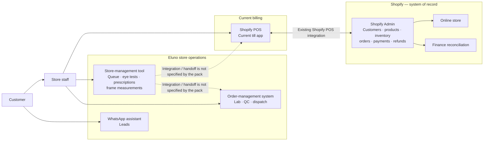
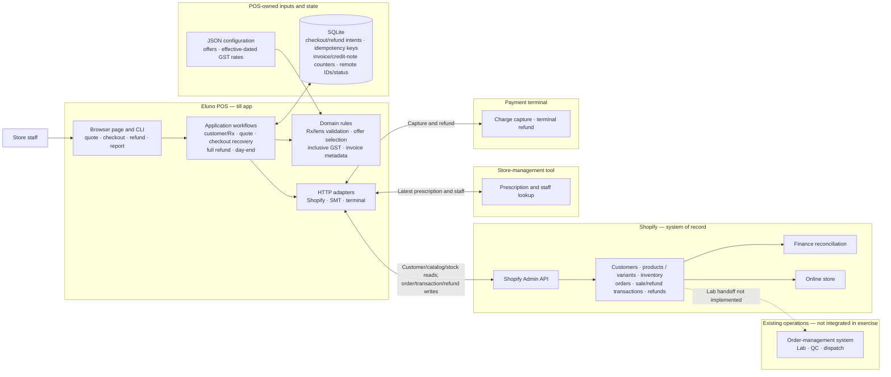

# Eluno POS architecture

Diagram one is the current setup described in the brief. Diagram two is what I built. Dotted arrows mark connections the brief does not explain or that this exercise leaves out.

## Current setup



## What this exercise builds

The browser page and the CLI both call the same workflows in `pos/service.py`. `server.py` serves the page, a small JSON API and the mock, so one process covers the whole demo. Workflows reach the outside world through `pos/adapters.py`; pricing and validation use plain dictionaries and integer paise, never Shopify objects.



### Data ownership

Shopify holds customers, products, stock, orders and refunds. The store tool supplies prescriptions and staff records; the terminal handles payments. GST rates and offers live in JSON. SQLite holds invoice counters and checkout/refund progress. This version does not send work to the OMS or track cash in the drawer.

## Checkout and refund flow

```mermaid
sequenceDiagram
    actor Staff as Store staff
    participant App as POS app
    participant DB as SQLite
    participant Shopify as Shopify Admin
    participant SMT as Store tool
    participant Terminal as Payment terminal

    Staff->>App: quote/checkout: phone, store, staff, frame+lens pair(s)
    App->>Shopify: Customer, locations, active catalog and frame stock
    Shopify-->>App: Customer/tags, store, variants and stock
    App->>SMT: Prescriptions by phone; staff by store
    SMT-->>App: Rx records and staff roster
    App->>App: Latest valid Rx; lens/axis checks; offers; GST per line
    App->>DB: Reserve invoice; persist prepared intent + stable checkout key
    App->>DB: Claim charge_pending
    App->>Terminal: Capture exact integer-paise total, order_ref=checkout key
    Terminal-->>App: Captured status + charge ID
    App->>DB: Persist charge ID + charged_order_pending + exact Shopify payload
    App->>DB: Claim shopify_create_pending
    App->>Shopify: Create order with tax, discounts, Rx line properties,<br/>invoice metadata, sale transaction and store inventory decrement
    Shopify-->>App: Shopify order / line / transaction IDs
    App->>DB: Mark complete, persist Shopify order ID
    App-->>Staff: Invoice number + Shopify order reference

    Note over App,DB: Explicit 429: honor Retry-After and resume same intent.<br/>Ambiguous write: look for remote key; if unresolved, stop for reconciliation.

    Staff->>App: Full refund by invoice + reason code
    App->>Shopify: Read original order; calculate full line refund/tax
    Shopify-->>App: Refundable amount and original sale transaction
    App->>DB: Reserve credit note; persist refund intent
    App->>DB: Claim terminal_pending
    App->>Terminal: Refund captured charge
    Terminal-->>App: Terminal refund ID
    App->>DB: Persist terminal success
    App->>Shopify: Refund original transaction; frame return at billing store;<br/>lens no_restock; credit-note metadata
    Shopify-->>App: Shopify refund record
    App->>DB: Mark refund complete
    App-->>Staff: Credit-note / refund reference
```

### Rules in the app

- A bill can contain several frame/lens pairs for one customer. Each pair can name its prescription; otherwise the app picks the latest valid one. Sphere and cylinder must fit the lens. Progressive and bifocal lenses need an ADD. An axis outside 0–180° or off the 5° grid is blocked for optometrist confirmation, never rounded.
- Offers come from JSON. Stackable offers can combine; non-stackable offers are evaluated alone. The permitted combination with the largest saving wins. A requested manager discount is mandatory, but it cannot combine with the other offers. Its reason and approver are written to the order. The mock has no real staff login.
- Prices include GST. The app selects the rate by HSN and effective date, works out tax per line after discounts, and splits it into CGST/SGST. Rounding is half-up in paise; Shopify gets decimal strings.
- A full refund uses Shopify's calculated amount. The frame returns to the original store; the made-to-order lens does not. Day-end sales use the sale date and refunds use the refund date. Finance should confirm that reporting rule.

## Recovery and mock limitations

Checkout and refund progress is saved in SQLite. The app retries a definite 429 using `Retry-After`. If a write times out and the result is unknown, it stops for reconciliation instead of sending it again.

The terminal mock has a bug worth knowing about: its docs say `order_ref` makes a charge idempotent, but repeating a successful charge creates another one. There is no refund status lookup either. The app also cannot safely retry a Shopify order create if the result is unclear. It searches for the checkout key, but the mock only returns the 250 oldest orders and has no lookup-by-key endpoint.

The invoice counter is one local SQLite file, so it is not ready for multiple tills across seven stores. A real rollout needs a shared counter, agreed rollover and void rules, staff authentication, backups and monitoring. Offline payments, cash drawer tracking, family billing, remakes, partial refunds, printing, scheduled email and the OMS/lab handoff are not in this exercise.

## References

- [Candidate brief](brief/CANDIDATE_BRIEF.md)
- [Stakeholder thread](brief/STAKEHOLDER_THREAD.md)
- [Starter-kit API and behavior notes](starter-kit/README.md)
- [Data ownership schema](starter-kit/schema.md)
- [Implementation and run instructions](README.md)
