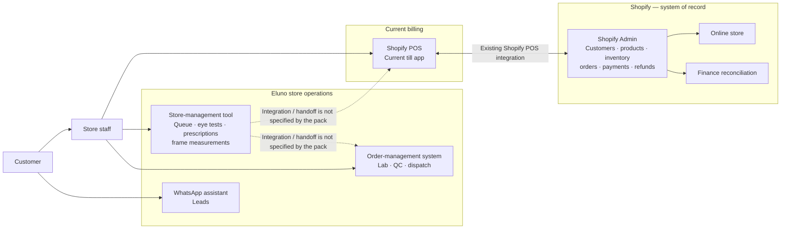
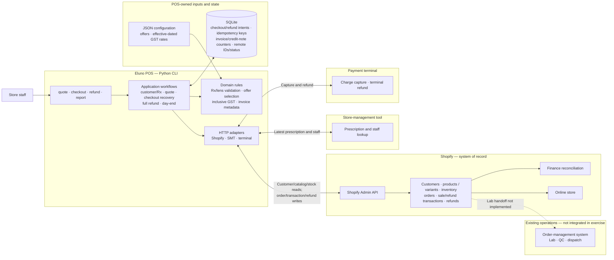

# Eluno POS architecture

The first diagram is my read of the current setup from the brief. The second shows what I built for the exercise. Dotted lines mean the brief doesn't say how those systems connect.

## Current setup



Shopify POS handles the sale today. Shopify holds customers, products, stock, orders and payments. The store tool handles the queue, eye tests and prescriptions; the OMS handles lab work and dispatch. The brief doesn't explain how the store tool and OMS connect to billing, so those links are left dotted.

## What this exercise builds

The app is a Python command-line program. The workflow calls the APIs through `pos/adapters.py`; the pricing and validation code works with plain dictionaries and integer paise. SQLite keeps checkout/refund progress and invoice counters. Shopify remains the record for customers, stock, orders and payments.



### Where data lives

Shopify owns customers, products, stock, orders and refunds. The store tool supplies prescriptions and staff records; the terminal handles charges and refunds. GST rates and offers are JSON files. SQLite keeps invoice counters and the state of interrupted checkouts/refunds; it isn't a second Shopify ledger. This exercise doesn't send work to the OMS or track cash-drawer movements.

## Checkout and refund flow

```mermaid
sequenceDiagram
    actor Staff as Store staff
    participant CLI as POS CLI / workflows
    participant DB as SQLite
    participant Shopify as Shopify Admin
    participant SMT as Store tool
    participant Terminal as Payment terminal

    Staff->>CLI: quote/checkout: phone, store, staff, frame+lens pair(s)
    CLI->>Shopify: Customer, locations, active catalog and frame stock
    Shopify-->>CLI: Customer/tags, store, variants and stock
    CLI->>SMT: Prescriptions by phone; staff by store
    SMT-->>CLI: Rx records and staff roster
    CLI->>CLI: Latest valid Rx; lens/axis checks; offers; GST per line
    CLI->>DB: Reserve invoice; persist prepared intent + stable checkout key
    CLI->>DB: Claim charge_pending
    CLI->>Terminal: Capture exact integer-paise total, order_ref=checkout key
    Terminal-->>CLI: Captured status + charge ID
    CLI->>DB: Persist charge ID + charged_order_pending + exact Shopify payload
    CLI->>DB: Claim shopify_create_pending
    CLI->>Shopify: Create order with tax, discounts, Rx line properties,<br/>invoice metadata, sale transaction and store inventory decrement
    Shopify-->>CLI: Shopify order / line / transaction IDs
    CLI->>DB: Mark complete, persist Shopify order ID
    CLI-->>Staff: Invoice number + Shopify order reference

    Note over CLI,DB: Explicit 429: honor Retry-After and resume same intent.<br/>Ambiguous write: look for remote key; if unresolved, stop for reconciliation.

    Staff->>CLI: Full refund by invoice + reason code
    CLI->>Shopify: Read original order; calculate full line refund/tax
    Shopify-->>CLI: Refundable amount and original sale transaction
    CLI->>DB: Reserve credit note; persist refund intent
    CLI->>DB: Claim terminal_pending
    CLI->>Terminal: Refund captured charge
    Terminal-->>CLI: Terminal refund ID
    CLI->>DB: Persist terminal success
    CLI->>Shopify: Refund original transaction; frame return at billing store;<br/>lens no_restock; credit-note metadata
    Shopify-->>CLI: Shopify refund record
    CLI->>DB: Mark refund complete
    CLI-->>Staff: Credit-note / refund reference
```

### A few implementation choices

- A bill can contain several frame/lens pairs for one customer. Each pair can name its prescription; otherwise the app picks the latest valid one. Sphere and cylinder must fit the lens. Progressive and bifocal lenses need an ADD. An axis outside 0–180° or off the 5° grid is blocked for optometrist confirmation, never rounded.
- Offers come from JSON. Stackable offers can combine; non-stackable offers compete on their own. The permitted choice with the greatest saving wins, with stable tie-breaks. A manager discount is different: if requested and authorized, it is applied on its own because the manager offer is marked non-stackable. The reason and approver go on the order. The mock has no real login, so this is not production authorization.
- Prices include GST. The app selects the rate by HSN and effective date, works out tax per line after discounts, and splits it into CGST/SGST. Rounding is half-up in paise; Shopify gets decimal strings.
- A full refund uses Shopify's calculated amount. The frame returns to the original store; the made-to-order lens does not. Day-end sales use the sale date and refunds use the refund date. Finance should confirm that reporting rule.

## Recovery and things to fix before production

SQLite records the checkout/refund states shown in the sequence diagram. Known 429 responses use `Retry-After`. When a write times out and we can't tell if it worked, the app stops for reconciliation rather than blindly sending it again.

There are two important mock limitations. Its docs say a terminal charge is idempotent by `order_ref`, but repeating a successful charge actually creates another one. The terminal also has no refund status lookup. The Shopify order-create endpoint isn't idempotent either; the app searches for its checkout key, but the mock only returns 250 oldest orders and has no lookup-by-key endpoint. These need real vendor/API support before safe automatic recovery in production.

Invoice counters use one local SQLite file, which is fine for this exercise but not seven stores or multiple tills. A real rollout also needs agreed invoice rollover/void rules, staff authentication, secret and customer-data protection, backups, monitoring, and an operations plan. Offline payment, cash-drawer tracking, family billing, remakes, partial refunds, printing, scheduled email and the OMS/lab handoff are not built here.

## References

- [Candidate brief](brief/CANDIDATE_BRIEF.md)
- [Stakeholder thread](brief/STAKEHOLDER_THREAD.md)
- [Starter-kit API and behavior notes](starter-kit/README.md)
- [Data ownership schema](starter-kit/schema.md)
- [Implementation and run instructions](README.md)
