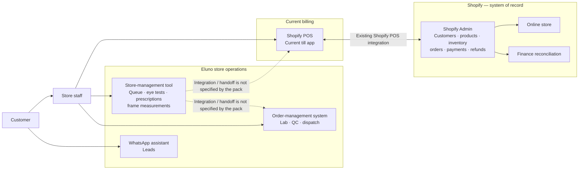
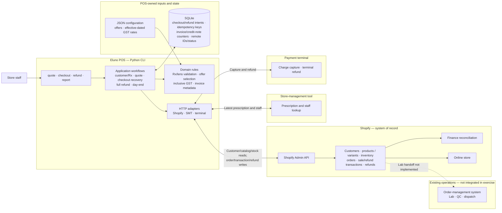

# Eluno Till — Architecture and HLD

Two diagrams below: how things are wired today (as far as the brief tells us), and how I've wired the exercise. Where the pack doesn't say how two non-Shopify systems talk to each other, I've drawn it as unknown rather than inventing a line. Goal is the same as the brief's: replace Shopify POS at the till, keep Shopify as the record, no UI needed.

## 1. Current-state HLD (as stated in the brief)



So today the staff member rings the sale up in Shopify POS, and Shopify already holds the customers, stock, orders and money. The store tool owns the queue, eye tests and prescriptions; the OMS owns lab and dispatch; WhatsApp just does leads. Note what the pack *doesn't* tell us: how the store tool and the OMS currently feed a sale at the till. That dotted line stays dotted until someone confirms it.

## 2. Target-state HLD (implemented exercise scope)

What I actually built: a CLI, some workflow code, and rules that only ever see plain dicts and paise. Anything that looks like Shopify JSON is confined to `pos/adapters.py` and the order/refund mapping in `service.py`. SQLite is there for two jobs only — remembering where an interrupted bill got to, and holding the invoice counters. It is deliberately *not* a second copy of Shopify's books.



### Ownership and boundary

| Capability/data | Owner | Implemented till behavior |
|---|---|---|
| Customer, tags, catalog, inventory, orders, transactions and refunds | Shopify | Read via Shopify adapter; create paid orders and full refunds via Shopify-shaped writes. |
| Prescriptions and seeded store staff | Store tool | Fetch by phone/store; select newest unexpired Rx; block invalid Rx/lens combinations. |
| Captures and terminal refunds | Terminal | Use checkout key as `order_ref`, persist returned charge/refund IDs, and stop on ambiguous outcome. |
| GST rates and offers | POS-owned JSON | Load at runtime; date/condition/stackability-aware discount evaluation and per-line tax math. |
| Invoice/credit-note counters and recovery intents | POS-owned SQLite | Atomically reserve per-store sequence and persist checkout/refund states and keys. |
| Lab order, QC, dispatch; cash-drawer operations | Existing systems / POS-owned future scope | Not implemented or sent to OMS in this exercise. |

## 3. Implemented checkout and refund flow

```mermaid
sequenceDiagram
    actor Staff as Store staff
    participant CLI as POS CLI / workflows
    participant DB as SQLite
    participant Shopify as Shopify Admin
    participant SMT as Store tool
    participant Terminal as Payment terminal

    Staff->>CLI: quote/checkout: phone, store, staff, frame+lens pair(s)
    CLI->>Shopify: Customer, locations, active catalog and frame stock
    Shopify-->>CLI: Customer/tags, store, variants and stock
    CLI->>SMT: Prescriptions by phone; staff by store
    SMT-->>CLI: Rx records and staff roster
    CLI->>CLI: Latest valid Rx; lens/axis checks; offers; GST per line
    CLI->>DB: Reserve invoice; persist prepared intent + stable checkout key
    CLI->>DB: Claim charge_pending
    CLI->>Terminal: Capture exact integer-paise total, order_ref=checkout key
    Terminal-->>CLI: Captured status + charge ID
    CLI->>DB: Persist charge ID + charged_order_pending + exact Shopify payload
    CLI->>DB: Claim shopify_create_pending
    CLI->>Shopify: Create order with tax, discounts, Rx line properties,<br/>invoice metadata, sale transaction and store inventory decrement
    Shopify-->>CLI: Shopify order / line / transaction IDs
    CLI->>DB: Mark complete, persist Shopify order ID
    CLI-->>Staff: Invoice number + Shopify order reference

    Note over CLI,DB: Explicit 429: honor Retry-After and resume same intent.<br/>Ambiguous write: look for remote key; if unresolved, stop for reconciliation.

    Staff->>CLI: Full refund by invoice + reason code
    CLI->>Shopify: Read original order; calculate full line refund/tax
    Shopify-->>CLI: Refundable amount and original sale transaction
    CLI->>DB: Reserve credit note; persist refund intent
    CLI->>DB: Claim terminal_pending
    CLI->>Terminal: Refund captured charge
    Terminal-->>CLI: Terminal refund ID
    CLI->>DB: Persist terminal success
    CLI->>Shopify: Refund original transaction; frame return at billing store;<br/>lens no_restock; credit-note metadata
    Shopify-->>CLI: Shopify refund record
    CLI->>DB: Mark refund complete
    CLI-->>Staff: Credit-note / refund reference
```

### Domain and money decisions

- Checkout accepts one or more prescription frame/lens pairs for one Shopify customer. Each pair can specify an Rx ID; otherwise the latest valid Rx is selected.
- Sphere/cylinder limits and progressive/bifocal ADD requirements come from the selected lens variant. Axis outside 0–180° or off the 5° grid is blocked with an optometrist-confirmation reason; it is never silently rounded.
- All offers are read from JSON and checked against active flag, inclusive date range, conditions, target, and stackability. A combination is allowed only if every selected offer is stackable; a non-stackable offer competes alone. Choose maximum total savings; ties prefer fewer offers and stable offer IDs. Priority determines deterministic application order. Flat pair/cart discounts are capped and allocated in paise.
- GST is inclusive, selected by HSN/effective date, and computed per line after discounts. Combined rate is split CGST/SGST; half-up rounding preserves each line's paisa reconciliation. Shopify receives decimal strings and `taxes_included: true`.
- Manager override is a requested percentage up to 10%, checked against same-store manager staff data, with reason and approver captured as order metadata. The mock has no authentication, so this is not a production authorization control.
- Full refund amount is obtained from Shopify's calculate response and checked against maximum refundable. The terminal refund precedes the Shopify refund; recovery state is durable. Frame restocks to original `location_id`, lens never restocks, and the Shopify refund transaction points to the sale transaction.
- Day-end reads Shopify. Sales are grouped by order business date; refunds by refund business date in IST. Gross is before discounts; taxable/tax are derived from line tax data; payment and refund totals are split by method.

## 4. Recovery state and production limits

- Checkout states include `prepared`, `charge_pending`, `charged_order_pending`, `shopify_create_pending`, `complete`, `void`, `void_refunded` and `needs_reconciliation`. Conditional SQLite state claims guard local side effects. Known 429s are retried with `Retry-After`; the same checkout key is reused.
- Refund states include `prepared`, `terminal_pending`, `terminal_succeeded`, `shopify_write_pending`, `shopify_refund_pending`, `complete` and `needs_reconciliation`. The terminal mock has no refund idempotency/status lookup, so ambiguous terminal outcomes are not retried automatically.
- The starter docs claim terminal charge idempotency by `order_ref`; implementation inspection shows repeated successful charges with the same reference create another charge. The adapter retries the mock's explicit simulated 503 with the same key as directed, but any ambiguous network result is held for reconciliation.
- Shopify order create is not idempotent. A unique `checkout_key` is written to order metadata and looked up before retry, but the mock has no searchable-key endpoint and returns only 250 oldest-first orders. Production needs pagination and authoritative lookup/webhook reconciliation before automatically retrying uncertain creates.
- SQLite invoice counters are atomic for this single-process exercise. Seven stores/multiple tills need a shared allocator, fiscal-year rollover and void policy sign-off. A reserved-but-failed invoice remains in the local intent history; it is not silently reused.
- The local intent queue does not authorize offline payments or guarantee offline inventory. Cash-drawer float/movements, family billing, remakes, partial refunds, printing, scheduled email, OMS/lab handoff and AI stretch features are out of scope.
- Production also needs staff authentication, secrets and PII protection, pagination, monitoring, backups, terminal/Shopify reconciliation and an operational rollout/support plan.

## 5. References

- [Candidate brief](brief/CANDIDATE_BRIEF.md)
- [Stakeholder thread](brief/STAKEHOLDER_THREAD.md)
- [Starter-kit API and behavior notes](starter-kit/README.md)
- [Data ownership schema](starter-kit/schema.md)
- [Implementation and run instructions](README.md)
